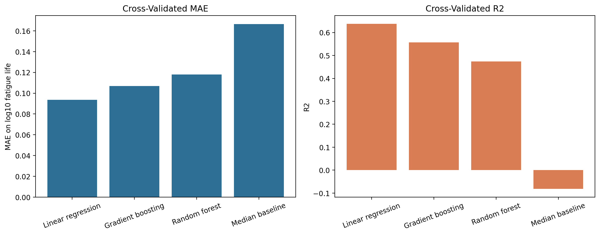
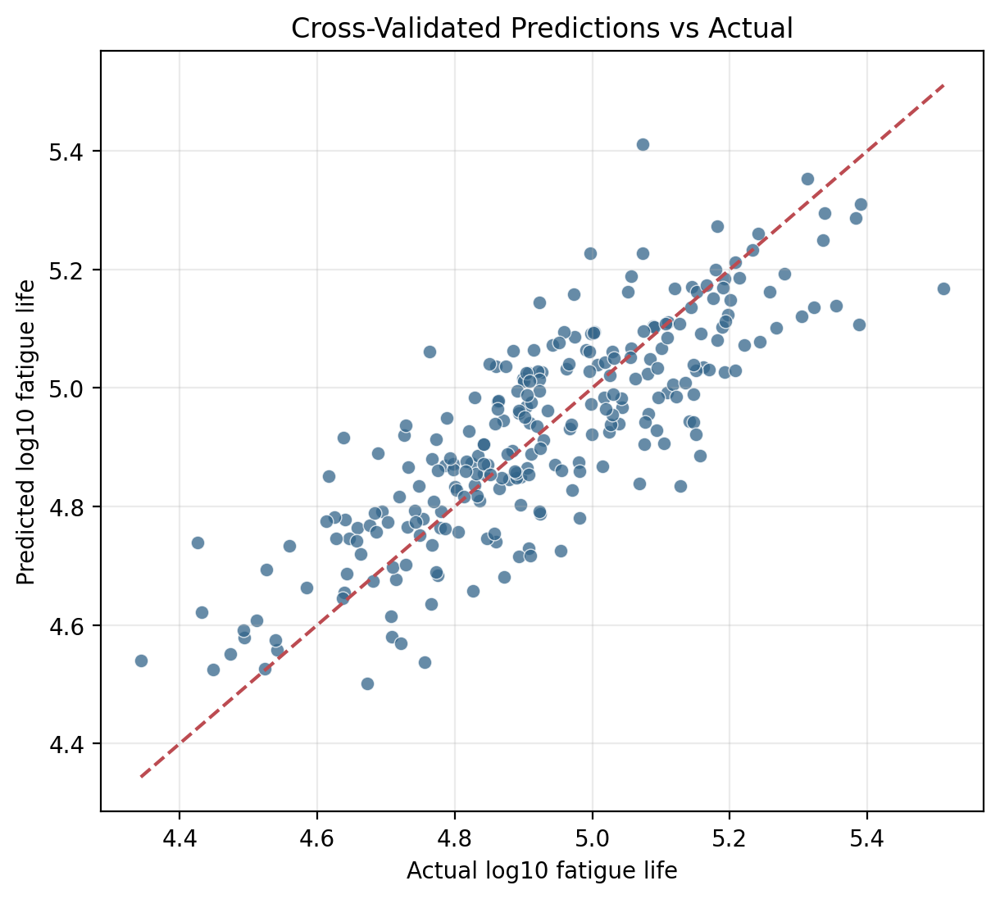
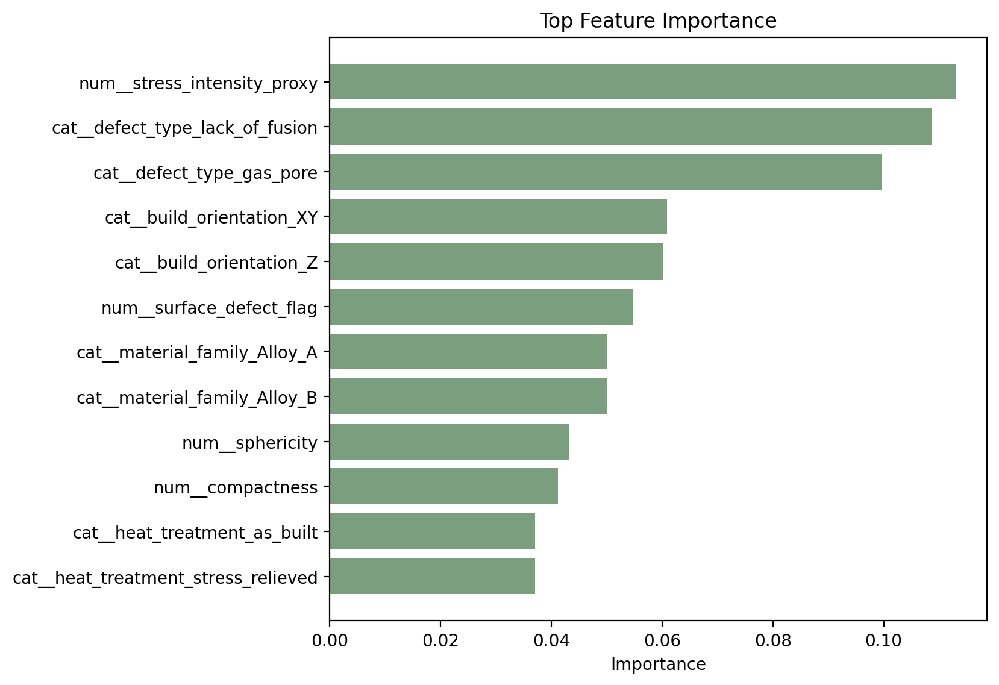

# defect-aware-fatigue-prediction

This project demonstrates a Python-based workflow for predicting fatigue life from defect descriptors in additively manufactured materials. The workflow includes data cleaning, feature engineering, model training, cross-validation, and performance visualisation. The example data are anonymised/simulated to protect project confidentiality.

## Business / Scientific Problem

In defect-sensitive materials systems, fatigue life can vary strongly even when nominal loading conditions look similar. Small changes in defect size, morphology, and proximity to the surface can shift crack initiation and shorten component life. A practical analytics workflow helps engineers and researchers:

- screen which defect descriptors matter most,
- compare simple and non-linear models,
- communicate prediction quality with transparent validation,
- build stakeholder trust without exposing confidential project data.

This portfolio version is intentionally simplified for GitHub. It uses synthetic data that mimic the structure of a defect-aware fatigue dataset while avoiding proprietary specimen information.

## What This Project Demonstrates

- A clean Python workflow using `pandas`, `numpy`, `scikit-learn`, and `matplotlib`
- Basic data cleaning and sanity checks
- Feature engineering from raw defect descriptors
- Model comparison across baseline and non-linear regressors
- Five-fold cross-validation with MAE, RMSE, and R2
- Clear plots for performance comparison and prediction behaviour

## Repository Structure

```text
defect-aware-fatigue-prediction/
|-- README.md
|-- requirements.txt
|-- .gitignore
|-- data/
|   `-- simulated_defect_fatigue_data.csv
|-- outputs/
|   |-- cv_metrics.csv
|   |-- model_comparison.png
|   |-- predictions_vs_actual.png
|   `-- top_feature_importance.png
`-- src/
    |-- generate_simulated_data.py
    `-- run_workflow.py
```

## Example Dataset

The sample dataset includes anonymised or simulated fields such as:

- `defect_size_um`
- `defect_depth_um`
- `sphericity`
- `compactness`
- `aspect_ratio`
- `local_stress_mpa`
- `relative_density_pct`
- `build_orientation`
- `defect_type`
- `heat_treatment`
- `fatigue_life_cycles`

The target is direct fatigue-life prediction in cycles. The workflow models `log10(fatigue_life_cycles)` for better stability and easier comparison across models.

## How To Run

### 1. Create an environment

```bash
python -m venv .venv
source .venv/bin/activate
pip install -r requirements.txt
```

### 2. Regenerate the simulated dataset

```bash
python src/generate_simulated_data.py
```

### 3. Run the full workflow

```bash
python src/run_workflow.py
```

The script writes metrics and plots to `outputs/`.

## Example Outputs

### Model Comparison



### Cross-Validated Predictions



### Top Engineered Features



## Notes On Confidentiality

- The dataset in this repository is simulated.
- Variable names are representative of a defect-aware fatigue study, but no industrial specimen records are included.
- The code is designed to show workflow quality and communication clarity rather than reproduce a confidential client dataset.

## Possible Extensions

- Add hyperparameter tuning with `GridSearchCV`
- Add uncertainty intervals or bootstrap resampling
- Add survival analysis for censored runout data
- Package the workflow as a small Streamlit or dashboard demo

